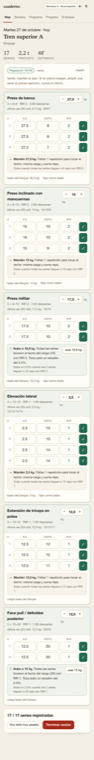
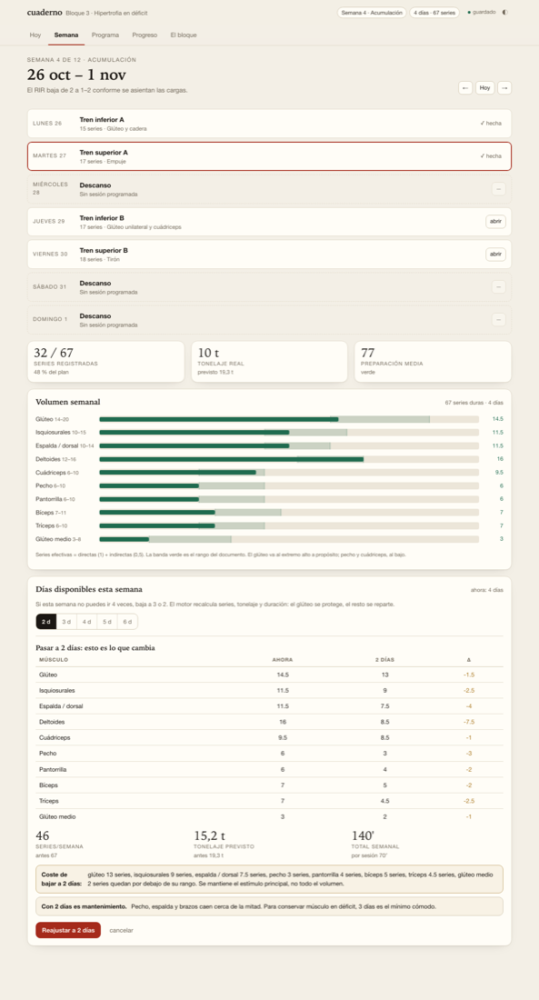

# Cuaderno · Hipertrofia en déficit

Programa de entrenamiento de hipertrofia para **4 días por semana que se reajusta solo** si esa semana solo puedes ir 2, 3, 5 o 6. Calcula volumen semanal, tonelaje, progresión y descargas, y guarda cada serie con sus kilos, repeticiones y RIR.

**App:** <https://cuaderno-hipertrofia-chi.vercel.app>

[](https://github.com/gilhdz320-prog/cuaderno-hipertrofia/actions/workflows/tests.yml)
[](LICENSE)



## Qué es

Un cuaderno digital que cabe en un solo archivo HTML, sin dependencias, sin cuenta y sin servidor. Está pensado para un bloque de hipertrofia en déficit calórico: mantener músculo, mejorar forma, y llegar al final del déficit con el terreno preparado para volver a fuerza.

El documento del bloque (por qué no es de fuerza, qué esperar del glúteo, qué se dejó fuera) vive dentro de la app, en la pestaña **El bloque**, y también como PDF en [`cuaderno-bloque.pdf`](cuaderno-bloque.pdf).

## Empezar

**En tu ordenador**

```bash
git clone https://github.com/gilhdz320-prog/cuaderno-hipertrofia.git
cd cuaderno-hipertrofia
open index.html          # o doble clic en abrir-cuaderno.command
```

**En el móvil (PWA)**

Abre <https://cuaderno-hipertrofia-chi.vercel.app> y añádela a la pantalla de inicio: iPhone → Compartir → *Añadir a pantalla de inicio*; Android → botón **Instalar** de la cabecera.

Espejo en GitHub Pages: <https://gilhdz320-prog.github.io/cuaderno-hipertrofia/>

**Versión imprimible**

Abre [`cuaderno-bloque.pdf`](cuaderno-bloque.pdf) o usa el botón *Imprimir* dentro de la pestaña **El bloque**.

> **Dónde se guardan los datos.** En el navegador, en el almacenamiento local del origen desde el que abres la app. No hay servidor ni cuenta. Si abres el archivo con `file://` y tu navegador bloquea el almacenamiento, verás un aviso: en ese caso usa el lanzador. Para mover el cuaderno de dispositivo: *Progreso → Copia .json*.

## Las cinco pestañas

| Pestaña | Para qué |
|---|---|
| **Hoy** | La sesión del día: kilos, reps y RIR por serie. Temporizador de descanso que arranca al marcar la serie, comparación con la última vez, consejo de progresión y botón «Hoy está muy pesado» (−5 %, sin tocar la carga base). |
| **Semana** | Calendario, series registradas, tonelaje real vs. previsto, volumen por músculo contra su rango y el selector de días con previsualización del reajuste. |
| **Programa** | Editar ejercicios, series, rango de reps, RIR, descanso y orden. Biblioteca de ejercicios propios y ajustes del bloque. |
| **Progreso** | Tonelaje por semana, preparación, carga y próxima subida por ejercicio, medidas corporales, exportar CSV/JSON. |
| **El bloque** | El documento completo, con las tablas generadas desde el programa real. |

## Cómo se reajusta al número de días

El selector está en **Semana**. Antes de aplicar nada enseña la tabla de antes/después por músculo, con el coste exacto.

| Días | Series/semana | Glúteo | Por sesión |
|---|---|---|---|
| 2 | 46 | 13 | 64–76 min |
| 3 | 58 | 16 | 55–63 min |
| **4** | **67** (+2 opcionales) | **14,5** | 46–54 min |
| 5 | 74 | 16,5 | 30–48 min |
| 6 | 78 | 13,5 | 28–44 min |

Reglas del motor:

1. **Series efectivas** = directas (1,0) + indirectas (0,5 por músculo secundario).
2. Cada músculo tiene un rango: glúteo 14–20, isquios 10–15, espalda 10–14, deltoides 12–16, cuádriceps 6–10, pecho 6–10, pantorrilla 6–10, bíceps 7–11, tríceps 6–10.
3. **Techo por sesión**: 18 series a 4 días (21 a 3, 23 a 2, 17 a 5, 16 a 6). Es el punto donde la sesión deja de caber en el tiempo disponible y empieza a costar recuperación.
4. **Prioridades protegidas**: al bajar de frecuencia, el glúteo, el femoral y el deltoides lateral son los últimos en recortarse.



Con 2 días la app no finge: avisa de que pecho, espalda y brazos caen cerca de la mitad y de que es mantenimiento, no el plan completo.

## Cómo progresa

Doble progresión, sin porcentajes mágicos:

1. La carga se mantiene hasta que **todas** las series tocan el techo del rango con el RIR objetivo.
2. Ahí sube un escalón pequeño: 2,5 % en tren superior, 5 % en tren inferior, redondeado al disco real (1,25 kg en barra de empuje, 2,5 kg en máquina, 1 kg en mancuernas ligeras).
3. Si una serie baja del mínimo del rango, o la primera llega a RIR 0, **baja un 5 %**.
4. Si faltan reps o RIR, **repite la carga**: no se inventa progresión.

En déficit, pasar de 8 a 10 repeticiones con el mismo peso es progresar. El récord no es el objetivo.

## Fases

| Semana | Fase | Qué cambia |
|---|---|---|
| 1 | Calibración | Cargas con 3 repeticiones en reserva |
| 2–5 | Acumulación | RIR baja de 2 a 1–2 |
| 6 | Descarga | Volumen a la mitad, RIR 3–4 |
| 7–11 | Intensificación | RIR 1–2, suben las repeticiones |
| 12 | Descarga y revisión | Medidas, fotos, preparación media |

La app calcula la semana desde la fecha de inicio del bloque y aplica la descarga sola.

## Instalar en el móvil (PWA)

La app es una **PWA instalable**: manifiesto, iconos, service worker y caché versionada. Instalada se abre a pantalla completa y funciona **sin cobertura**, que es lo que hace falta en un sótano de gimnasio.

**iPhone / Safari:** abre la URL → Compartir → *Añadir a pantalla de inicio*.

**Android / Chrome:** abre la URL → aparece el botón **Instalar** en la cabecera (o menú → *Instalar aplicación*).

Qué queda cacheado: el HTML completo (la app entera), el manifiesto y los iconos. El service worker usa *red primero* para la navegación y caché para el resto: si hay conexión recibes la versión nueva, y si no, abre la última que viste.

### Dónde publicarla

La PWA funciona igual en cualquiera de los tres, pero **el origen importa**: los datos se guardan por dominio. Si instalas desde uno y luego te mudas, el cuaderno instalado y el nuevo no comparten registros (se pasan con *Progreso → Copia .json*). Decide la URL definitiva **antes** de instalarla en el móvil.

| Opción | Estado | Cuándo |
|---|---|---|
| **GitHub Pages** | ya activo: <https://gilhdz320-prog.github.io/cuaderno-hipertrofia/> | ahora mismo, sin configurar nada |
| **Vercel** | listo para importar (`vercel.json` incluido) | si quieres dominio propio, CDN y despliegues por push |
| **Netlify** | opcional (`netlify.toml` incluido) | solo si quieres conservar `powerbuilgin.netlify.app` |

**Vercel (recomendado si vas a mudarte):** <https://vercel.com/new> → importa `cuaderno-hipertrofia` → framework *Other*. No toques nada más: el repo trae `vercel.json` con el build (`node build.mjs && node tools/pack.mjs`) y el output directory (`public/`), así que el deploy funciona por defecto. Queda en `cuaderno-hipertrofia.vercel.app` y cada push republica.

Si un deploy anterior falló con *«No Output Directory named public»*, es porque Vercel estaba esperando una carpeta que la primera versión del repo no generaba: ya está corregido en `vercel.json`, solo hay que pulsar **Redeploy**.

**Netlify:** en el sitio, *Site configuration → Build & deploy → Link repository* → elige el repo, rama `main`, build vacío, publish `.`.

### Comprobarlo tú

```bash
npm run pwa https://tu-url
```

Verifica manifiesto, iconos, instalabilidad, service worker y que la app abre sin conexión. Ahora mismo pasa 15/15 contra el sitio publicado.

## Estructura

```
.
├── index.html                  app completa (generada; no editar a mano)
├── manifest.webmanifest        PWA: nombre, iconos, atajos
├── sw.js                       service worker (generado; caché con hash)
├── icons/                      iconos 192, 512, maskable y apple-touch
├── vercel.json                 build + output public/ + cabeceras
├── cuaderno-bloque.pdf         documento del bloque
├── abrir-cuaderno.command      lanzador con servidor local
├── src/
│   ├── shell.html              esqueleto
│   ├── styles.css
│   ├── engine.js               lógica pura: volumen, tonelaje, progresión, fases
│   └── app.js                  interfaz
├── tests/engine.test.mjs       12 pruebas del motor
├── tools/
│   ├── e2e.mjs                 21 pruebas de interacción en Chrome real
│   ├── shot.mjs                capturas con emulación de móvil
│   ├── pdf.sh                  genera el PDF
│   ├── icons.py                regenera los iconos
│   ├── pwa-check.mjs           15 comprobaciones de PWA en Chrome real
│   └── pack.mjs                genera public/ (lo que sirve Vercel)
├── build.mjs                   empaqueta src/ en index.html
└── .github/workflows/tests.yml CI: motor + verificación del HTML
```

## Desarrollo

Requiere Node ≥ 20 (sin dependencias).

```bash
npm run build   # regenera index.html y sw.js desde src/
npm run pack    # genera public/ (app + PWA + PDF) para desplegar
npm test        # 12 pruebas del motor
npm run e2e     # 21 pruebas de interacción (necesita Chrome)
npm run pdf     # regenera cuaderno-bloque.pdf (necesita Chrome)
npm run pwa <url>  # comprueba manifiesto, SW y offline contra una URL
```

`index.html` está versionado a propósito: así GitHub Pages lo sirve sin construir nada. La CI falla si lo editas sin reconstruirlo.

El motor (`src/engine.js`) no toca el DOM ni el almacenamiento: se puede probar con `node --test` y se inyecta en la interfaz. Por eso la lógica de volumen y progresión está cubierta por pruebas y la parte visual no.

## Datos y privacidad

- No hay backend, ni cuentas, ni analítica. Nada sale del navegador.
- Las cargas de partida son una **estimación** sobre el peso corporal (hip thrust 1,1 ×, RDL 0,7 ×, banca 0,4 ×…). La semana 1 existe para corregirlas: manda el primer registro, no la estimación.
- El nombre de la atleta empieza como «Atleta»; se cambia en *Programa → Ajustes*.
- Un navegador, un dispositivo. Para dos sitios, exporta e importa el `.json`.

## Licencia

MIT. Ver [LICENSE](LICENSE).
